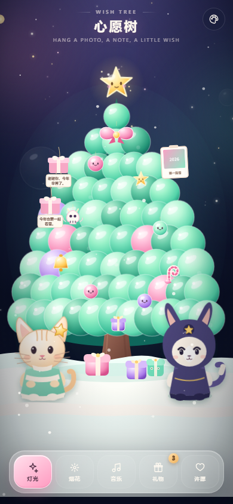

# 心愿树 · Wish Tree

一棵可以**挂照片、挂文字、许愿**的树。整个应用就是一个 `index.html`：不联网、不安装、无外链依赖，双击就能玩，手机竖屏优先。

> A tiny wish tree in one 106 KB HTML file. Hang photos or notes, switch between five moods, and leave a wish on the star — everything stays on your device.

更多预览：[五种风格](preview-themes.png) · [礼物详情](preview-gift.png)

## 快速开始 / Quick start

| 方式 | 步骤 |
| --- | --- |
| 下载即用 | 下载本仓库 → 双击 `index.html`（Edge / Chrome / Safari） |
| 在线试玩 | <https://dsjsunu.github.io/wish-tree/> |
| 发给朋友 | 部署到任意静态托管，或在微信里打开这个网址 |

不需要 Node、Python 或任何构建步骤。

## 能做什么

| 操作 | 反馈 |
| --- | --- |
| 点树上的 10 个小装饰 | 泡泡爆闪、音效、进度提示；集齐 10 个触发烟花 |
| 点小猫「橘子」/ 小狐「柚子」 | 弹出台词气泡、角色弹跳、爱心星星粒子 |
| **挂礼物** | 上传一张照片，或写一句话；礼物会挂在树枝上 |
| **点树上的礼物** | 打开卡片，看大图或完整文字，可以编辑、删除 |
| **换风格**（右上角调色盘） | 午夜松林 / 奶油晨光 / 黑金夜宴 / 樱花黄昏 / 极光森林 |
| 点顶部星星 / 底部「许愿」 | 许愿卡；愿望保存在本地，变成树梢上的小吊牌 |
| 点树梢「✦ N」吊牌 | 查看已许下的愿望 |
| 双击空白处 / 点「烟花」 | Canvas 粒子烟花 |
| 点「灯光」 | 整棵树变暗 / 重新点亮 |
| 点「音乐」 | WebAudio 合成的八音盒版 Jingle Bells |

## 挂礼物

- **照片**：选一张图，自动压到最长边 560px（JPEG），挂在树上的相框里，可以再配一句 16 字以内的说明。
- **文字**：最多 60 字，会印在礼物盒下面的小吊牌上。
- **编辑**：点开礼物 → 「编辑」，可以改文字、换照片、换盒子颜色，位置不变。
- **删除**：点开礼物 → 「删除」，需要点两次确认。
- 一棵树最多挂 **10 份**礼物，按左右交替的位置依次挂上去。
- 照片和文字都只存在**浏览器本地**，不上传任何服务器。清理浏览器数据会丢失，重要内容请自行留底。

## 五种风格

右上角的调色盘可以随时切换，选择会记住：

- **午夜松林**：深紫夜空 + 薄荷绿泡泡（默认）
- **奶油晨光**：浅奶油白天 + 淡绿树
- **黑金夜宴**：黑底 + 香槟金与墨绿
- **樱花黄昏**：紫粉天空 + 樱花色树
- **极光森林**：深海青 + 极光青绿

换风格只改颜色，不改变你挂的礼物和许下的愿望。

## 技术实现

- **树**：60 个带高光、渐变的 SVG 圆泡叠成锥形；背后一层剪影防止漏底，再加 34 个呼吸小灯、10 个可互动装饰。
- **角色**：纯 SVG 手绘的原创小猫「橘子」和小狐「柚子」，不依赖任何外部素材。
- **礼物**：运行时创建 SVG 相框 / 礼物盒与吊牌，照片用 `clipPath` 裁切；新增礼物有单独的下落动画。
- **风格**：整套配色用 CSS 自定义属性驱动，渐变 `stop` 直接引用变量，切换时只有颜色在过渡。
- **储存**：`localStorage`（愿望、礼物、风格各一个键）；图片压缩后再存，10 份照片大约几百 KB。
- **声音**：WebAudio 振荡器合成，首次点击后才创建 `AudioContext`，不自动播放。
- **性能**：静态 SVG 不逐帧重绘；Canvas 只画雪和粒子；`document.hidden` 时暂停音乐；支持 `prefers-reduced-motion`。
- **微信适配**：`viewport-fit=cover` + 安全区、禁止下拉回弹与双击缩放、`text-size-adjust:100%`、不用 ES Module 和外部字体。

已在 320×568、390×844、1280×900 三种尺寸实测，无控制台报错、无横向溢出。

## 自定义

| 想改什么 | 位置 |
| --- | --- |
| 标题与文案 | `<title>`、`<h1>`、`.sub` |
| 风格配色 | CSS 里的 `:root` 与 `body[data-theme="..."]` |
| 礼物位置 | JS 里的 `GIFT_SLOTS` |
| 礼物盒颜色 | `GIFT_COLORS` |
| 礼物上限 | `GIFT_SLOTS` 的条数 |
| 角色台词 | `momoLines` / `yuzuLines` |
| 音乐旋律 | `melody` 数组，格式 `[MIDI 音高, 拍数]` |
| 角色造型 | `<g id="momo">` 和 `<g id="yuzu">` |

## 数据与隐私

- 所有内容只保存在当前浏览器的 `localStorage`：
  - `wish-tree-wishes-v1` 愿望
  - `wish-tree-gifts-v1` 礼物（照片是压缩后的 dataURL）
  - `wish-tree-theme-v1` 当前风格
- 没有任何网络请求，照片不会上传。
- 清除浏览器数据、换浏览器、换设备都会丢失。

## 素材与许可

- 角色、礼物盒、相框、树与所有插画都是项目内的**原创 SVG**，不含第三方角色素材。
- Jingle Bells 旋律属于公有领域，音色由 WebAudio 实时合成。
- 代码以 [MIT](LICENSE) 许可发布，可自由使用、修改、商用。

## English

A single-file wish tree: 60 glossy SVG bubbles, two original hand-drawn mascots, five color themes, and hanging gifts that can be a photo or a note. Gifts can be edited and deleted; everything is stored locally with no network calls. No dependencies — open `index.html` and play. MIT licensed.

---

愿你挂上去的每一件，都有人记得。
